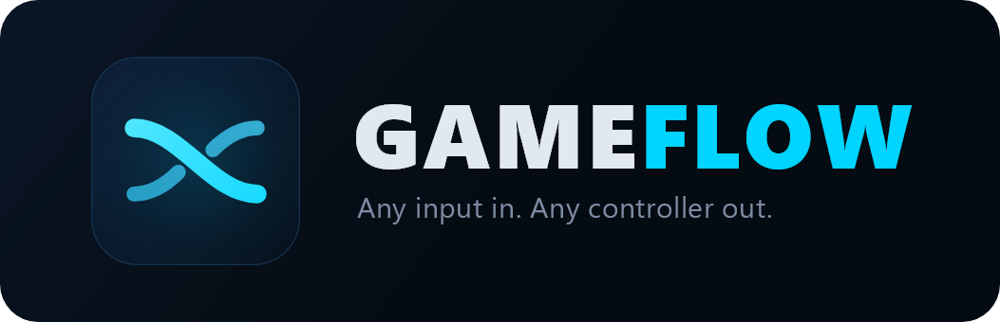
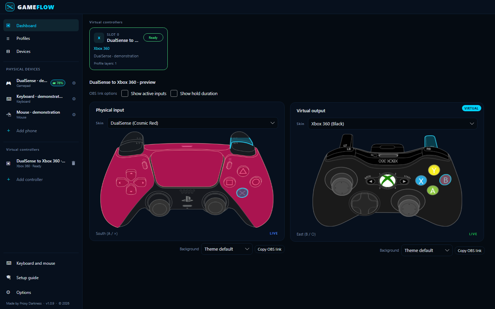
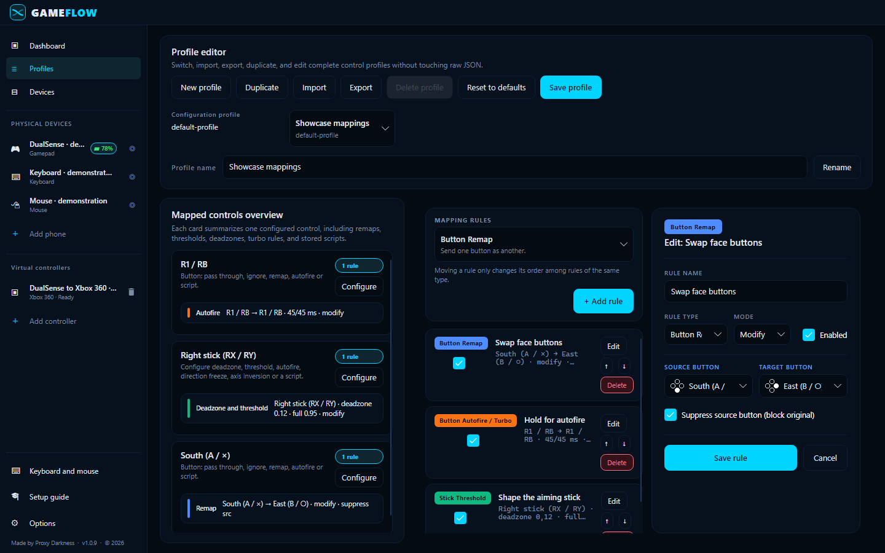
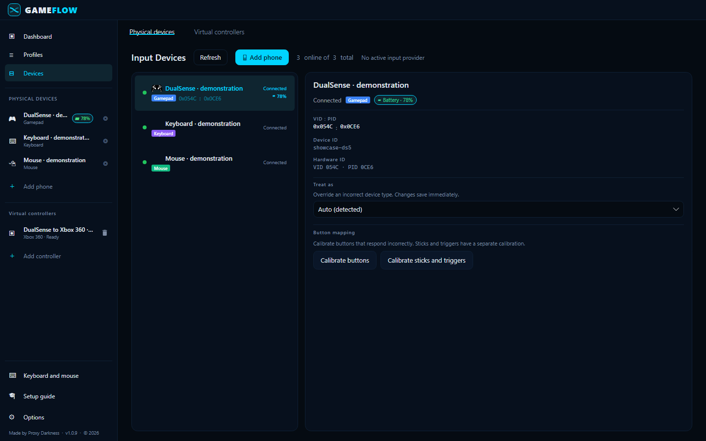

<div align="center">



**Cross-platform gamepad tooling for anyone.**

**Any input in. Your controller mapping out.**

**v1.1.0** · Built with **.NET 10** · **Avalonia UI** · **SDL3** · **HIDMaestro**

[](LICENSE)
[](#requirements)

---

[](https://buymeacoffee.com/ProxyDarkness)

Using and sharing the project also helps. Thank you!

---

[Download](https://github.com/Prooxie/GameFlow/releases/latest) · [Project page](https://prooxie.github.io/GameFlow/) · [Wiki](WIKI.md)

</div>

GameFlow maps gamepads, keyboards, mice, and phone browsers to controller outputs.
Each slot has its own inputs, profiles, output type, and physical-device settings.
You can use up to 16 slots.



These captures show actual application controls with isolated demonstration data.
They show Preview output and do not prove physical-device operation.

## Features

- Remap buttons, axes, sticks, triggers, gyro input, and touchpad input.
- Configure autofire, timed sequences, shift layers, formulas, and trusted Lua scripts.
- Save profiles and assign several input devices to one slot.
- Configure separate keyboard and mouse maps for each physical device.
- Configure supported rumble, adaptive triggers, lightbars, and indicator LEDs.
- Use a phone browser as an input device.
- Copy a transparent browser overlay into OBS.
- Change the UI language while the application is open.



## Requirements

Release archives include .NET 10 and SDL3 native libraries.
Extract the complete archive before you start the application.
Keep `themes`, `Localization`, and `appsettings.json` beside the executable.

| Platform | Input and mouse output | Virtual gamepad output |
| --- | --- | --- |
| Windows x64 | SDL3 and native keyboard/mouse input. | HIDMaestro. Requires a compatible SDK and Administrator access. |
| Linux x64 | SDL3, evdev input, and uinput mouse output. Requires device permissions. | Native standard gamepad through `uinput`. Requires `/dev/uinput` write access. |
| macOS ARM64/x64 | SDL3, IOHIDManager input, and CGEvent mouse output. Requires Input Monitoring permission. | Experimental standard HID gamepad through IOKit. Requires Apple-approved virtual HID signing. |

The macOS input implementation has no physical-device test in this release review.
Linux needs a graphical desktop and the system libraries that Avalonia requires.
The Linux archive targets glibc.
Local cross-published macOS archives are unsigned.
CI signs and notarizes macOS archives when the required signing secrets are configured.
Unsigned macOS builds retain input, mapping, OBS, and dashboard previews. They cannot create a virtual gamepad.

Windows virtual output requires `HIDMaestro.Core.dll` version 2.0.1 or a later 2.x version.
Obtain that optional SDK from [HIDMaestro](https://github.com/hifihedgehog/HIDMaestro).
Put the DLL beside `GameFlow.exe`, inside its `HIDMaestro` folder, or in `GAMEFLOW_HIDMAESTRO_DIR`.
Run GameFlow as Administrator when you need virtual controllers.
GameFlow reports a missing or unsupported SDK.
Dashboard previews remain available when output is disabled.
The release archives do not include the HIDMaestro SDK.

Physical Bluetooth controllers remain selectable beside matching virtual outputs.
USB DualSense and supported DualShock 4 outputs send complete battery, motion, and touch reports.
A virtual output with no battery source reports full capacity.

Each archive has a SHA-256 checksum file.
The checksum checks file integrity and is not a digital signature.

## Linux virtual gamepads

GameFlow uses the kernel's [uinput interface](https://docs.kernel.org/input/uinput.html).
Install the supplied group-based rule from the extracted archive:

```sh
sudo groupadd --force uinput
sudo usermod --append --groups uinput "$USER"
sudo install -m 0644 platform/linux/70-gameflow-uinput.rules /etc/udev/rules.d/
sudo modprobe uinput
sudo udevadm control --reload-rules
sudo udevadm trigger --subsystem-match=misc --sysname-match=uinput
```

Sign out and sign in to apply the new group membership.
Check `test -w /dev/uinput` in your new desktop session.
Some distributions use another device-permission manager. Follow their equivalent group and device rules.
Run GameFlow from your desktop session after this setup.

Linux and macOS emit a standard gamepad with two sticks, two triggers, a directional pad, and nineteen mapped buttons.
Saved Xbox and Sony templates use this standard output on these platforms.
Custom device shapes and virtual rumble, lighting, touch, motion, and adaptive-trigger reports remain Windows features.
Physical input, mappings, motion streaming, and OBS retain their separate capabilities.
Games must accept generic HID or evdev controllers. Some games need a Steam Input mapping.
The macOS output does not claim compatibility with every GameController-framework game.

## macOS virtual gamepads

Open the extracted `GameFlow.app` bundle.
Its runtime assets and documentation are inside `GameFlow.app/Contents/MacOS`.
Input Monitoring consent controls keyboard and mouse input.
Virtual output separately requires Apple's [virtual HID entitlement](https://developer.apple.com/documentation/bundleresources/entitlements/com.apple.developer.hid.virtual.device).
An unsigned or ad-hoc signature does not grant that entitlement.
The [release guide](docs/release.md#macos-signing) describes provisioning, signing, and notarization.
Native output remains experimental until a signed build passes a real Mac game test.

## Dashboard response

The dashboard reads current snapshots on display frames.
Changed state reaches controller art during the same UI refresh.
Device inventory updates run twice per second.
A temporary UI stall no longer lowers the dashboard rate for several seconds.
The dashboard refresh setting remains an upper limit. Automatic mode follows the detected display rate, with a 60 Hz fallback.
The display and compositor determine the actual presentation rate.
OBS retains its separate snapshot and browser rendering path.

## Quick start

1. Download the archive for your platform.
2. Extract all files into one folder.
3. Start `GameFlow.exe` on Windows, `./GameFlow` on Linux, or `GameFlow.app` on macOS.
4. Open the setup guide.
5. Select the physical devices that you want to use.
6. Select the virtual controller type.
7. Assign a profile and inspect the physical and virtual surfaces on the dashboard.

Disable the slot output when you want to inspect mappings without creating a virtual controller.
Enabled slots use the platform output backend. Missing permissions leave a visible output warning.
The Devices page shows output failures and missing capabilities.



## Map inputs

Open **Profiles** to add or change mapping rules.
You can also click a controller control on the dashboard to open its focused editor.
Click keyboard keys or mouse controls to edit their input maps.
Select the physical device before you change a device-specific map.

The keyboard picture uses an ANSI 104-key layout.
The editor also accepts supported extra keys, including F13–F24 and Numpad Enter.
The mouse view supports five buttons, vertical wheel directions, and motion.
Horizontal scrolling and precision-touchpad gestures are not separate mapping controls.

Rule passes have a defined order.
Later rules of the same type can override earlier rules.
Read the [rule reference](WIKI.md#rule-reference) before you combine complex profiles.
Imported Lua scripts start disabled.
Review a script before you enable it.
Lua limits do not provide process or memory isolation.

## Connect a phone

1. Open **Devices** and select **Add phone**.
2. Enable phone sharing when you need access from another device.
3. Scan that phone's private code or open its link on the same trusted network.
4. Assign the phone to a virtual controller.

Phone model choices change the browser layout.
The slot output type controls the virtual hardware protocol.
Removing a phone clears its assignments and revokes its private link.
HTTP does not encrypt these links.
Keep them private and use a trusted network.
Browser vibration and motion features depend on browser support and permissions.

## Add an OBS overlay

1. Open the dashboard panel that you want to show.
2. Select its skin and background.
3. Enable active-input text or hold duration if you need them.
4. Select **Copy OBS link** and paste the URL into an OBS Browser source.

The overlay follows the selected physical or virtual panel.
It uses the same geometry and snapshots as the native view.
Each panel has an independent background.
The URL retains the selected options.
See [OBS input options](docs/obs-inputs.md).

## Configure physical effects

Open the controller's tuning editor to configure supported effects.
Unsupported effects remain unavailable.
Saved settings and runtime transport remain separate.

Lightbar precedence is low-battery alert, external API request, eligible game feedback, then the configured effect.
Disable the low-battery alert when you do not want that override.
External requests expire and prefer device targets over slot targets over the global target.
Player LEDs and the microphone LED have their own supported settings and game-feedback choices.

Rumble gain applies before trigger feedback links.
Adaptive-trigger feedback uses the stronger motor level and returns to the configured effect between events.
The output queue combines pending updates and avoids unchanged writes.
See [effect settings](WIKI.md#per-device-tuning) and [the lighting API](WIKI.md#external-lighting-api).

## Data and updates

GameFlow stores settings and profiles in its application data folder.
Set `GAMEFLOW_DATA_DIRECTORY` to an absolute path when you need an isolated data folder.
Back up that folder before an upgrade.
Profile migration preserves existing rule types and supplies defaults for new fields.

The updater downloads and verifies a release archive.
Quit GameFlow before you extract and replace the application files.
The updater does not replace a running installation.

## Languages

English, Czech, German, Spanish, French, Italian, Polish, and Russian are available in Options.
Open labels and pickers follow language changes.
Device names, user profile names, key legends, scripts, and technical SDK diagnostics retain their source text.
Read [the translation guide](docs/localization.md) before you add UI text.

## Build and test

Use the .NET SDK specified by `global.json`.

```powershell
dotnet restore GameFlow.sln --locked-mode
dotnet build GameFlow.sln -c Release --no-restore -warnaserror
dotnet test --solution GameFlow.sln -c Release --no-build
pwsh ./scripts/Test-LocalizationChecks.ps1
```

Browser checks use the pinned Playwright version in `tests/browser`.

```powershell
cd tests/browser
npm ci --ignore-scripts
npx --no-install playwright install chromium firefox
npm test
```

Set `GAMEFLOW_TEST_BROWSER=firefox` to select Firefox.
Read [the release guide](docs/release.md) for local packages, checksums, Git tags, and Pages deployment.

## Verification limits

- Real game output, physical feedback, and hot-plug need device and game tests.
- Real phone browsers and OBS need a hardware check.
- macOS hardware behavior needs device tests.
- Hosted CI checks Windows, Linux, macOS, Chromium, and Firefox.
- GameFlow does not hide physical controllers from games. Configure a separate hiding tool if your game reads duplicate input.
- Remote Link and native Linux/macOS virtual gamepad output remain planned.

Read the [1.1.0 release notes](CHANGELOG.md#110) for changes and verification limits.

## License and credits

GameFlow uses the [MIT license](LICENSE).
[Third-party notices](THIRD-PARTY-NOTICES.md) identify bundled dependencies and artwork.

- [HIDMaestro](https://github.com/hifihedgehog/HIDMaestro) provides the optional Windows virtual controller SDK.
- [AL2009man](https://github.com/AL2009man/Gamepad-Asset-Pack) provides controller, prompt, and connection artwork.
- [VSCView](https://github.com/Nielk1/VSCView) provides the compatible controller theme format.
- [SDL3](https://github.com/libsdl-org/SDL) provides controller input.
- [MoonSharp](https://www.moonsharp.org/) provides Lua execution.

[Support Proxy Darkness](https://buymeacoffee.com/ProxyDarkness) · [YouTube](https://www.youtube.com/@ProxyDarkness) · [Twitch](https://www.twitch.tv/ProxyDarkness)

---

## Thanks to

**Nazzareno96** provides feedback and beta testing.
[twitch.tv/nazzareno96](https://www.twitch.tv/nazzareno96)

**NoobKillerRoof** reports hardware and software problems and provides beta testing.
[twitch.tv/noobkillerroof](https://www.twitch.tv/noobkillerroof)
