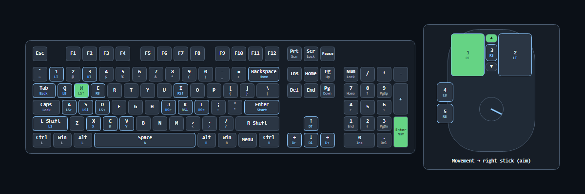

# Keyboard and mouse in OBS

Pin a physical input on the dashboard, or assign inputs to a virtual controller. The physical panel shows the keys and mouse controls you use. The virtual panel shows what the game receives.

1. Choose the panel's skin and background in GameFlow.
2. Select **Show active inputs** or **Show hold duration** if you want those details in OBS.
3. Use **Copy OBS link** beneath the physical or virtual panel you want to show.
4. Add a Browser source in OBS and paste the link. A transparent background is used unless the panel has an explicit background colour.

The link follows the selected dashboard skin. Keyboard and mouse panels use the same geometry, binding legends and live snapshots in the app and browser. Their movement and wheel feedback do not read or drain the device a second time. Keep a lone physical device pinned while using its OBS source.

This capture uses isolated demonstration data: W, Numpad Enter, the left mouse button, wheel-up and mouse movement are active. It shows actual application controls.

## Separate devices and extra controls

Open keyboard/mouse mapping and choose the physical device to edit. A device-specific map overrides shared defaults. Separate mice can drive different sticks. Pin individual devices when you want to inspect each map separately; a combined panel uses the first keyboard and first mouse for its binding legends.

The keyboard picture is a fixed ANSI 104-key layout. The mapping editor can capture other supported key codes, including F13–F24 and Numpad Enter. Optional OBS input text also names keys outside the pictured layout.

The current mouse picture and mapping support five buttons, vertical wheel-up/down and movement. Additional vendor buttons, horizontal scrolling and precision-touchpad gestures are not represented as independent controls. Laptop input enumeration still needs platform and hardware checks. These limits are tracked in the quality report.

Hold duration starts when an active input is observed and ends when it is released. Controller stick and trigger readouts become active beyond 5% deflection. A lost connection clears the text while retaining the last controller picture during reconnection.

The automated browser checks cover Chromium. Firefox tests are configured in CI; the local Windows test browser could not start on this review computer. Real phone browsers and OBS still need a hardware pass before release.
